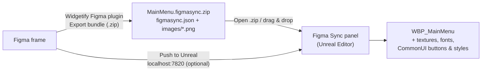

# Widgetify: Figma → UMG sync

Design a menu in Figma, press one button in Unreal, and get a ready-to-edit Widget Blueprint with textures, fonts and
CommonUI hooks wired.

> **Figma owns the look; Unreal owns the behavior.** Re-sync updates layout, colors, text and art, and never touches
> your graphs, bindings or animations.



There are no Figma REST calls, so there are no API tokens and no rate limits. The Figma plugin exports from inside
Figma (JSON + PNGs), and an editor-only Unreal plugin builds the Widget Blueprint. Nothing ships in your game.

## What's in the box

| Path | What it is |
| --- | --- |
| [`figma-plugin/`](figma-plugin/) | The Figma plugin (TypeScript). It exports the selected frame as a `figmasync` bundle, or pushes it straight to the editor. |
| [`unreal/Plugins/Widgetify/`](unreal/Plugins/Widgetify/) | The Unreal plugin, with three editor-only modules: **FigmaSyncCore** (bundle model, parser, zip reader; no editor dependencies, unit-tested), **FigmaSyncEditor** (importer, re-sync, panel, lint, live push) and **FigmaSyncCommonUI** (optional CommonUI layer). |
| [`samples/`](samples/) | `MainMenu.figmasync.zip`, a sample bundle ("Sovereign Call" main menu), plus an extracted copy to read. |
| [`schema/figmasync.schema.json`](schema/figmasync.schema.json) | JSON Schema for the bundle format. |
| [`docs/`](docs/) | [Architecture](docs/ARCHITECTURE.md), the [naming & tags guide](docs/NAMING.md) and the [bundle format](docs/SCHEMA.md). |

## Quick start

### 1. Install the Unreal plugin

1. Copy `unreal/Plugins/Widgetify` into your project's `Plugins/` folder.
2. Open the project and let Unreal build the plugin. The project needs to be a C++ project; in a Blueprint-only
   project, add any C++ class once (Tools → New C++ Class) so plugins can compile.
3. *(Optional)* Enable **CommonUI** (Edit → Plugins) to get CommonUI buttons, styles and activatable screens. Without
   it, Widgetify makes plain UMG buttons and `UserWidget` screens.

Supported engine versions are **UE 5.3 to 5.7**. Version differences are handled in code with
`UE_VERSION_OLDER_THAN` gates.

### 2. Try the sample (no Figma needed)

Open **Tools → Figma Sync** and click **Try sample**. You get a preview of the layer → widget tree. Then click
**Create Widget Blueprint**. You'll get `/Game/UI/Figma/WBP_MainMenu` with its textures, a generated `WBP_Btn_Primary`
CommonUI button and its `BS_`/`TS_` style assets.

### 3. Install the Figma plugin

1. Build it once: `cd figma-plugin && npm install && npm run build`. Skip this step if `figma-plugin/dist/` is
   already there.
2. In the **Figma desktop app**, open **Plugins → Development → Import plugin from manifest…** and pick
   `figma-plugin/manifest.json`.

### 4. Export a frame

Select a top-level frame, then run **Plugins → Development → Widgetify**. Then do one of these:

- **Export bundle (.zip)**: in Unreal, use **Open .zip…** (or drop the file onto the Figma Sync panel), pick a target,
  and import.
- **Push to Unreal**: first turn on **Project Settings → Plugins → Widgetify (Figma Sync) → Live Push**. The first
  push of a frame opens in the panel. After you import it once, later pushes re-sync that Widget Blueprint
  automatically.

To re-sync later, use the **Figma Sync** button in the Widget Blueprint editor toolbar, or right-click a Widget
Blueprint and choose **Figma Sync: Re-sync**. Either one re-imports from the bundle the Blueprint was last synced from.

## Naming cheat sheet

Layer names drive everything. The full guide is in [docs/NAMING.md](docs/NAMING.md).

| In Figma | In Unreal |
| --- | --- |
| `Btn_Play` | A button, exposed as the variable `Btn_Play`. |
| `Txt_PlayerName` | A text block, exposed as a variable. `Img_`, `Ico_`, `Pnl_`, `Box_`, `Lst_`, `Bar_`, `Inp_` and `Act_` are exposed too. |
| Instance of a `Btn/Primary` component | One generated CommonUI button class per component set. `Btn/Primary` → `WBP_Btn_Primary`, with button and text styles built from the `State=Hover/Pressed/Disabled/Selected` variants. |
| `Act_Back [action=Back]` | A CommonActionWidget (input glyph) bound to the `Back` action. |
| `[img] Frame_Border` | Rasterized to a PNG, then shown as an Image with a texture brush. |
| `[img 3x] Logo` · `[img:Background] Hero` · `[img slice=16] Panel` | Rendered at 3×, imported with the *Background* texture preset, or drawn as a 9-slice box with 16 px margins. |
| `[skip] Notes` | Ignored. |
| `[focus] Btn_Play` | Initial gamepad/keyboard focus (Desired Focus Widget). |
| `[action=Back] Btn_Back` | Bound to a CommonUI input action (a data table row or `IA_Back`). |
| `[var]` / `[novar]` · `[button]` / `[nobutton]` · `[overlay]` / `[canvas]` · `[widget]` | Force or prevent: exposing as a variable, making a button, the panel type, or (on the frame) using a plain `UserWidget` parent. |

## How Figma maps to UMG

| Figma | UMG |
| --- | --- |
| Horizontal / vertical auto-layout | `HorizontalBox` / `VerticalBox`. Spacing becomes slot padding; fill and hug become slot sizing. |
| Wrapping auto-layout | `WrapBox`. |
| No auto-layout | `CanvasPanel`, with anchors and offsets from the constraints. |
| Frame with fill, stroke or radius | `Border` with a rounded-box brush around the panel. |
| Rectangle, ellipse or line with a simple style | `Image` with a rounded-box brush. |
| Text | `TextBlock`, with the font from the mapping table, size in pt (px × 0.75) and letter spacing, alignment, wrapping and case. |
| Gradients, shadows, blurs, vectors, masks, image fills | Rasterized PNGs → `Image`. Textures use per-preset sRGB, compression and mip settings, and unchanged PNGs are skipped on re-sync. |
| `Btn/*` component instance | A generated CommonUI button (or a plain UMG `Button` without CommonUI). |
| Hidden layer, opacity, rotation | `Collapsed`, render opacity, render transform. |

Colors are converted from Figma's sRGB to the linear colors Slate expects. 1 Figma px = 1 Slate unit at the design
resolution, which defaults to 1920×1080 and can be changed in Project Settings.

## Re-sync rules

- Widgets are matched by **Figma node id**, never by position or name. Renaming a layer in Figma keeps its widget and
  the widget's name, so your graph references survive.
- Look properties (layout, brushes, fonts, text, art) are updated in place. **Graphs, bindings and animations are never
  touched.**
- Widgets you add by hand stay where you put them.
- Layers deleted in Figma are **flagged in the lint report, not deleted**. To delete them instead, turn off *Keep Removed
  Widgets* in Project Settings.
- The **lock list** in the Figma Sync panel protects chosen widgets: their layout, appearance, text or children.
- Each import or re-sync is a single undo transaction. It writes an import log, and nothing fails silently.

## Lint report

Every import ends with a lint pass. It checks for:

- missing or broken focus paths;
- buttons that can't be focused;
- `[action=...]` tags with no matching input action;
- back buttons with no Back action;
- fonts with no mapping (and the fallback used instead);
- button-named layers that can't be clicked;
- frames whose size doesn't match the design resolution;
- layers removed in Figma.

## Development

```bash
cd figma-plugin
npm install
npm run check      # typecheck + unit tests + build (also regenerates samples/ deterministically)
npm run watch      # rebuild dist/ on save while developing in Figma
```

To run the Unreal tests, open **Session Frontend → Automation** in the editor and run `FigmaSync`. Or from the
command line:

```bash
UnrealEditor-Cmd YourProject.uproject -ExecCmds="Automation RunTests FigmaSync; Quit" -unattended -nullrhi
```

## Status and limits (v1)

- **Beta.** The Unreal code targets UE 5.3–5.7 but hasn't been through CI on every engine version yet. If it doesn't
  compile on yours, please open an issue with the error.
- Out of scope for v1: animations, prototyping flows, complex vector effects (these are rasterized instead) and gameplay
  logic.
- Mixed text styles in one layer use the dominant style. A Rich Text Block can show every run; that isn't automatic yet.
- Live push uses `http://localhost:7820`. Figma only allows localhost for development plugins (`devAllowedDomains`), and
  newer Chromium builds may ask once for **local network access**; allow it. If you change the port in Project Settings,
  change it in `figma-plugin/manifest.json` too.
- While Live Push is on, the editor accepts bundles on that port from any app or page that can reach it, and a push
  can re-sync a bound Widget Blueprint. It's off by default; turn it on while you iterate on a screen.
